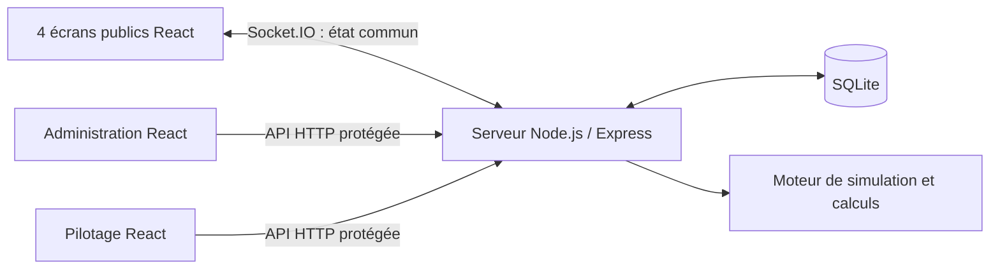

# CH8 — Démo de gamification industrielle

Application web full-stack conçue par **Henri Evrad Ngamaleu Tchako** pour présenter un dispositif de gamification d’une ligne de production. **Projet personnel de démonstration, réalisé avec assistance IA ; données simulées, sans connexion MES réelle ni déploiement industriel revendiqué.**

## Ce que montre le projet

- **4 écrans publics synchronisés / 20 zones** : objectifs, scores, défis, comparaisons, communication et indicateurs.
- **Administration** : planning des équipes, objectifs, contenus, signalements et suivi des arrêts.
- **Pilotage présentateur** : parcours guidés, pause, accélération et retour au fonctionnement normal.
- **Historique persistant** : calculs côté serveur, transactions SQLite et migrations.
- **Tests automatisés** : API, droits d’accès, calculs, changements de quart, redémarrage et reconnexion de plusieurs clients.

## Stack

| Couche | Technologies |
|---|---|
| Interfaces | React, TypeScript, CSS, Vite |
| Backend | Node.js, Express, TypeScript |
| Synchronisation | Socket.IO / WebSockets |
| Données | SQLite, better-sqlite3, migrations SQL |
| Tests | Node.js test runner, Supertest, clients Socket.IO |
| Images | Sharp, SVG |

## Architecture



Le serveur reste la source commune des données. Les écrans affichent le même instantané ; ils ne fabriquent pas de compteurs indépendants. Le mode normal et les scénarios temporaires ont des historiques séparés.

## Difficultés résolues

1. **Cohérence temporelle** : quarts de nuit, changement de jour/mois et calendrier Africa/Douala, avec reprise des périodes planifiées après redémarrage.
2. **Calculs vérifiables** : production et bonus séparés, récompenses attribuées une seule fois, fusion des arrêts qui se chevauchent pour éviter le double comptage.
3. **Scénarios isolés** : accélérer une présentation sans réécrire l’historique normal ni perdre les contenus de l’administration.
4. **Clients reconnectés** : renvoyer l’état courant après une coupure, sans recréer une simulation ni doubler un bonus.
5. **Conversions de volumes** : calcul des hectolitres depuis le nombre de bouteilles et la contenance réelle de chaque produit ; pas d’hypothèse de format unique.
6. **Affichage** : quatre tableaux de cinq zones, adaptation aux résolutions de navigateur et textes longs sans masquer les indicateurs.

## Installation locale

Node.js **24 LTS recommandé**, version 22 ou supérieure. Les dépendances SQLite et Sharp sont natives.

```sh
npm ci
cp .env.example .env
```

Renseigner **localement** deux mots de passe différents dans `.env` : `CH8_ADMIN_PASSWORD` et `CH8_PRESENTER_PASSWORD`. Aucun mot de passe réel n’est fourni dans le dépôt. Sans ces variables, les comptes correspondants restent désactivés. Les identifiants de la copie publique sont `admin-demo` et `presenter-demo`.

```sh
npm run build
npm start
```

Adresses : `http://localhost:3080/ecrans`, `/admin`, `/pilotage`. La base est créée dans `data/`, exclu de Git. Le serveur écoute localhost par défaut. Ce prototype local ne doit pas être exposé tel quel sur Internet.

Sous Windows, copier `.env.example` vers `.env` puis utiliser les commandes npm ci-dessus dans PowerShell ; les lanceurs hérités restent des outils de démonstration à valider sur la machine cible.

## Vérifications

```sh
npm run typecheck
npm test
```

Validation de la copie publique le 19 octobre 2026 : **TypeScript valide, compilation Vite réussie et 130 tests automatisés réussis**. Les tests ont été exécutés après la compilation.

Le test runner configure des mots de passe publics **réservés aux tests isolés** ; ils ne configurent pas le serveur de démonstration. Les tests couvrent les règles métier et API, et non une validation physique de l’usine.

## Périmètre et limites

- Les indicateurs de production, de ressources et de rendement sont ceux d’une simulation. Le rendement provisoire n’est pas un TRS industriel validé.
- Aucune intégration MES, amélioration chiffrée de productivité ou relation d’emploi/client n’est revendiquée.
- La lecture physique sur grands écrans, l’essai sur un second ordinateur et l’exécution Windows restent à valider.
- Copie publique préparée sans base existante, portraits, documents de référence privés, sessions, jetons ou identifiants locaux. Les noms et données de référence sont ceux de la démonstration publique.

## Contribution personnelle

Cadrage du besoin de démonstration, choix des comportements, priorisation et itérations fonctionnelles, simulations, vérification des calculs et préparation de la présentation. Développement réalisé avec l’assistance de Codex, avec revue des résultats et tests. Ce dépôt sert de preuve de projet et de support d’entretien ; il ne constitue pas une expérience salariée.

**Portfolio :** [Banshe](https://banshe.io) · [GitHub](https://github.com/henri237code)
